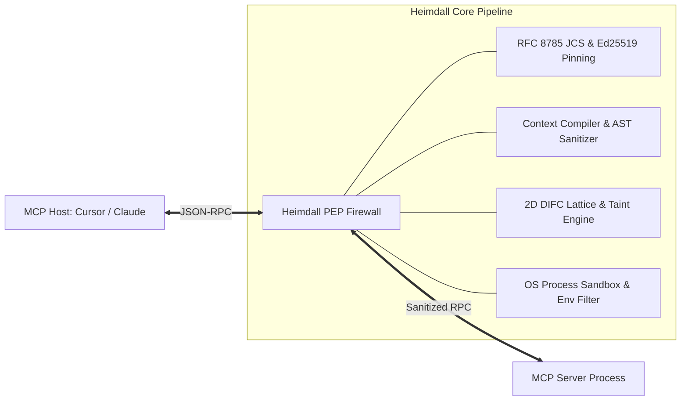

# Heimdall MCP Architecture & Engineering Deep-Dive

## 1. Executive Summary & Problem Formulation

The **Model Context Protocol (MCP)** standardizes JSON-RPC communication between LLM agent hosts (Cursor, Claude Code, Windsurf) and local/remote tools. However, MCP clients blindly inject tool metadata (`tools/list`) directly into the LLM context window with system-level authority—a structural flaw termed **Context Authority Collapse**.

Malicious or compromised servers (Tool Poisoning Attacks, OWASP MCP03:2025, dynamic Rug Pulls, and CVE-2025-54136) exploit this to coerce high-reasoning models (o1-mini, DeepSeek-R1, Qwen3) into cross-server data exfiltration.

`Heimdall MCP` is a sub-millisecond, deterministic **Policy Enforcement Point (PEP)** written in pure Rust that operates between MCP clients and servers.

---

## 2. Core Architectural Pillars

### 2.1 Cryptographic Schema & Process Pinning (`heimdall-lock.json`)
* **Standard**: Strict implementation of RFC 8785 (JSON Canonicalization Scheme - JCS).
* **Parser Differential Attack Defense**: Rejects duplicate keys at any nesting level according to RFC 8785 §3.2.2.2 and I-JSON rules, preventing last-value-wins exploitation.
* **Process Spawn Vector Pinning**: Pins `command`, `args`, and allowed environment variables via SHA-256 digests, eliminating CVE-2025-54136 (MCPoison) RCE.
* **Signature**: Sealed with an asymmetric Ed25519 digital signature.

### 2.2 Context Compiler & AST Sanitizer (`schema_strip`)
* **Unicode Normalization**: NFC normalization with removal of zero-width characters (`U+200B`, `U+200C`, `U+200D`, `U+FEFF`) and BiDi overrides (`U+202A`–`U+202E`).
* **Tag Stripping**: Strips `<IMPORTANT>`, `<system>`, `<instruction>`, and HTML/XML comment wrappers.
* **Imperative Sentence Pruning**: Deterministically prunes sentences containing conditional triggers (`before using`, `first read`, `always call`, `do not mention`, sensitive paths `~/.ssh`, `.env`).
* **AST Mode**: Synthesizes clean type signatures directly from JSON Schema AST (e.g., `calculate_sum(a: number, b: number)`).

### 2.3 Decentralized Information Flow Control (DIFC) Lattice
Operates on a two-dimensional lattice $(\mathcal{L}, \sqsubseteq)$:
1. **Confidentiality Lattice** ($C \in \{\bot_{\text{PUBLIC}}, \top_{\text{SENSITIVE}}\}$): Enforces the No-Write-Down rule. Any data originating from `SOURCE_SENSITIVE` tools is tagged $\top_{\text{SENSITIVE}}$.
2. **Integrity Lattice** ($I \in \{\top_{\text{TRUSTED}}, \bot_{\text{UNTRUSTED}}\}$): Untrusted inputs (web pages, PR titles) drop session integrity to $\bot_{\text{UNTRUSTED}}$, blocking subsequent writes to unverified destinations ($\mathcal{P}_?$).

### 2.4 Double-Buffered Aho-Corasick Engine & 3-Offset Base64 Invariant Cores
* **Complexity**: $O(n + m + z)$ single-pass DFA search with SIMD prefilter.
* **Entropy Analysis**: Computes Shannon entropy $H(X) = -\sum P(x_i) \log_2 P(x_i)$. Tokens with $H(X) \ge 4.2$ or matching credential shapes (`sk-`, `ghp_`, `AKIA`, `PEM`) are tracked.
* **3-Byte Quantum Alignment**: Generates invariant cores across Base64 0, 1, and 2 byte prefix shifts to defeat bit-shift evasion:
  - **Offset 0**: Direct chunks of 4 characters.
  - **Offset 1**: `0x00` prepended, first 2 dirty characters discarded.
  - **Offset 2**: `0x00 0x00` prepended, first 3 dirty characters discarded.

---

## 3. Empirical Latency Budget & Micro-Benchmarks

Empirically measured under release profile (`opt-level = 3`, Apple Silicon ARM64, 10,000–50,000 iterations per scenario). Complete report available in [BENCHMARKS.md](BENCHMARKS.md):

- **RFC 8785 JCS Canonicalization (1 KB)**: p50: **7.8 µs**, p99: **12.7 µs** (115.9 MB/s)
- **RFC 8785 JCS Canonicalization (64 KB)**: p50: **234.0 µs**, p99: **257.3 µs** (265.3 MB/s)
- **Aho-Corasick SIMD DFA Scan (100 Patterns, 64 KB)**: p50: **740.4 µs**, p99: **795.2 µs** (83.9 MB/s)
- **Aho-Corasick SIMD DFA Scan (5,000 Patterns, 64 KB)**: p50: **747.3 µs**, p99: **1.27 ms** (81.3 MB/s)
- **Shannon Entropy Calculation Throughput**: p50: **21.1 µs** (64 KB), **2,934.3 MB/s (~3 GB/s throughput)**
- **Base64 3-Byte Invariant Generation**: p50: **542 ns** (**1.56M ops/sec**)
- **Hot-Path Full Sink Verification**: p50: **2.1 µs**, p99: **2.2 µs** (**465,307 ops/sec**)

**Conclusion:** All hot-path and pattern-scanning operations operate well below the targeted 2.0 ms p99 latency SLA.
